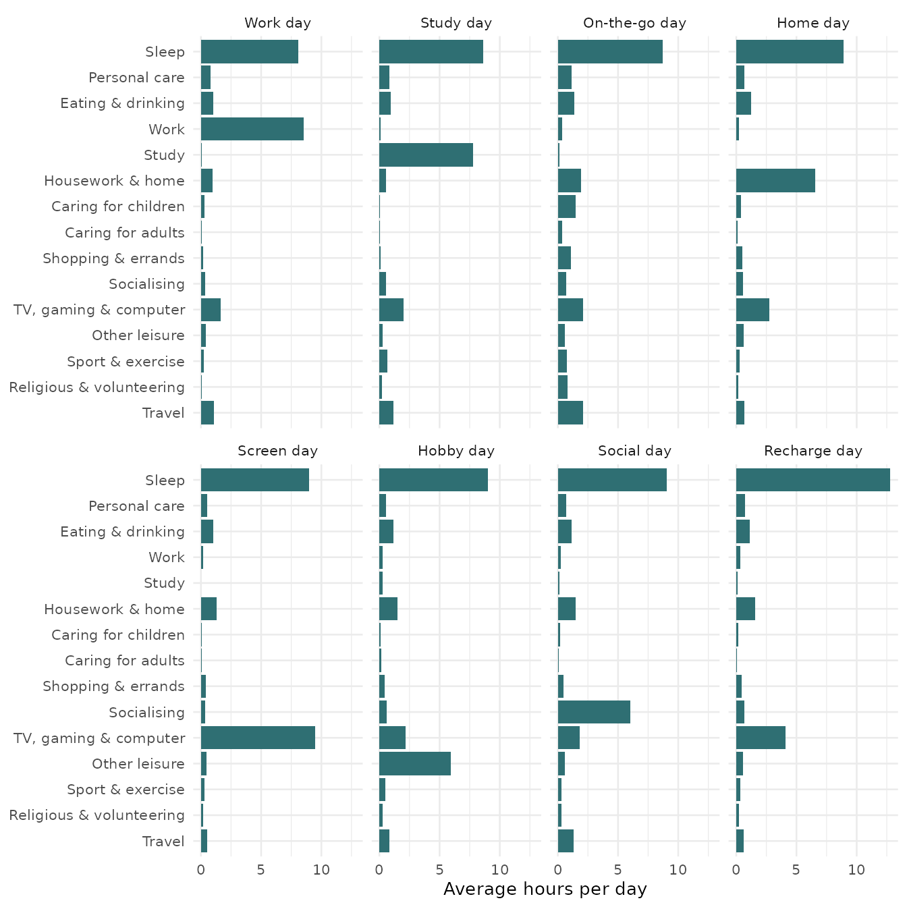

# Whose Day Is It? Using dayalike

## Who this is for

`dayalike` is for anyone curious about how they spend their time. It
answers one question:

> **Which kind of day did I have, and what makes it that kind of day?**

It compares one day of your time use with eight types of day found in
the diaries of 6,146 people in the 2025 American Time Use Survey (ATUS),
run by the U.S. Bureau of Labor Statistics.

## Install the package

``` r

# install.packages("remotes")
remotes::install_github("ETC5523-2026/etc5523-assignment-4-tzhu0035-png")
```

``` r

library(dayalike)
library(dplyr)
library(tidyr)
library(ggplot2)
```

## Launch and use the app

``` r

run_app()
```

The app has three pages.

**Your day.** In the sidebar, either start from an example day or enter
the hours you spent on each of the 15 activities during one day, from
waking up to waking up the next morning. Use quarter hours (0.25 = 15
minutes) and leave activities you did not do at 0. Tick *Show 7 more
activities* to see the less common ones. The box at the bottom keeps a
running total out of 24 hours.

The main panel then shows:

1.  **Your best match**: the type your day looks most like, a one-line
    description, roughly how many hours of your day would need to move
    to match it, the next closest type, and who usually has this kind of
    day.
2.  **What makes your day this type?** One row per activity: red dots
    are your hours and grey dots are the average day of the type. The
    rows are sorted from the biggest difference to the smallest, so the
    top rows explain most of the match. Use *Compare my day with* to
    compare with any other type.
3.  **How close is each type?** The hours that would need to move to
    match each type. Shorter bars are closer. The dashed line marks a
    *close match*: 95% of real survey days are within that many hours of
    their closest type.

**The eight types** shows the average day of each type and who has it.
**About the data** explains the source and the limitations below.

The app explains what is wrong instead of failing when the day cannot be
matched: when the hours add up to more than 24, when nothing has been
entered, when a box is left empty, and when no type is a close match. It
also warns when more than two hours of the day are not assigned to any
activity, because an emptier day looks less like every type.

## The eight types

``` r

day_types |>
  select(day_type, tagline, share, pct_weekend, mean_age, pct_employed) |>
  mutate(across(where(is.numeric), round)) |>
  knitr::kable(col.names = c("Day type", "What it looks like", "% of days",
                             "% on a weekend", "Average age", "% employed"))
```

| Day type | What it looks like | % of days | % on a weekend | Average age | % employed |
|:---|:---|---:|---:|---:|---:|
| Work day | Most of the day goes to paid work. | 34 | 8 | 42 | 99 |
| Study day | Classes and study fill the day. | 4 | 12 | 20 | 28 |
| On-the-go day | Out and about: travel, errands and caring for others. | 14 | 37 | 48 | 48 |
| Home day | Housework, cooking and looking after the home. | 13 | 34 | 56 | 37 |
| Screen day | Long stretches of TV, gaming or computer time. | 13 | 44 | 55 | 33 |
| Hobby day | Time for reading, relaxing, music and hobbies. | 5 | 40 | 54 | 34 |
| Social day | Hours spent with friends, family or at social events. | 4 | 54 | 49 | 50 |
| Recharge day | A long sleep, well beyond the usual. | 11 | 46 | 43 | 45 |

``` r

day_type_profiles |>
  left_join(activity_categories, by = "category") |>
  mutate(label = factor(label, levels = rev(activity_categories$label))) |>
  ggplot(aes(x = minutes / 60, y = label)) +
  geom_col(fill = "#2F6F73") +
  facet_wrap(~day_type, nrow = 2) +
  labs(x = "Average hours per day", y = NULL) +
  theme_minimal(base_size = 10)
```



## Use the functions directly

Describe a day as a named vector of hours. Names come from
`activity_categories$category`; activities you leave out count as zero.

``` r

my_day <- c(sleep = 7.5, personal_care = 1, eating = 1, work = 9,
            housework = 1, screen = 2.5, travel = 1.5, exercise = 0.5)

match_my_day(my_day)
#> # A tibble: 8 × 5
#>    rank day_type      tagline                            hours_apart close_match
#>   <int> <fct>         <chr>                                    <dbl> <lgl>      
#> 1     1 Work day      Most of the day goes to paid work.        2.13 TRUE       
#> 2     2 On-the-go day Out and about: travel, errands an…        8.86 FALSE      
#> 3     3 Recharge day  A long sleep, well beyond the usu…        9.95 FALSE      
#> 4     4 Home day      Housework, cooking and looking af…       10.1  FALSE      
#> 5     5 Social day    Hours spent with friends, family …       10.1  FALSE      
#> 6     6 Hobby day     Time for reading, relaxing, music…       10.1  FALSE      
#> 7     7 Study day     Classes and study fill the day.          10.3  FALSE      
#> 8     8 Screen day    Long stretches of TV, gaming or c…       10.5  FALSE
```

The best match is a *Work day*: only about two hours of this day would
have to move for it to look like the average Work day, and it is a close
match. Every other type is more than eight hours away.

[`compare_day()`](https://etc5523-2026.github.io/etc5523-assignment-4-tzhu0035-png/reference/compare_day.md)
shows why, activity by activity:

``` r

compare_day(my_day, "Work day")
#> # A tibble: 15 × 5
#>    category            label                      you typical difference
#>    <chr>               <chr>                    <dbl>   <dbl>      <dbl>
#>  1 screen              TV, gaming & computer      2.5  1.64      0.862  
#>  2 sleep               Sleep                      7.5  8.07     -0.565  
#>  3 work                Work                       9    8.53      0.474  
#>  4 other_leisure       Other leisure              0    0.409    -0.409  
#>  5 travel              Travel                     1.5  1.09      0.406  
#>  6 socialising         Socialising                0    0.355    -0.355  
#>  7 childcare           Caring for children        0    0.291    -0.291  
#>  8 exercise            Sport & exercise           0.5  0.255     0.245  
#>  9 personal_care       Personal care              1    0.794     0.206  
#> 10 shopping_services   Shopping & errands         0    0.175    -0.175  
#> 11 education           Study                      0    0.0944   -0.0944 
#> 12 religious_volunteer Religious & volunteering   0    0.0804   -0.0804 
#> 13 housework           Housework & home           1    0.947     0.0529 
#> 14 adult_care          Caring for adults          0    0.0439   -0.0439 
#> 15 eating              Eating & drinking          1    1.01     -0.00889
```

This day has a little more screen time and work, and a little less
sleep, than the average Work day.

## How the types were made

The data are prepared in `data-raw/atus_days.R`:

1.  The ATUS Activity Summary file records the minutes each respondent
    spent on several hundred detailed activities during one day. These
    were grouped into the 15 categories in `activity_categories`.
2.  The days were grouped into eight types with k-means clustering on
    the 15 categories, weighted by the survey weights because weekends
    are over-sampled in the ATUS.
3.  Each type was named after the activity that is furthest above the
    average day.

[`match_my_day()`](https://etc5523-2026.github.io/etc5523-assignment-4-tzhu0035-png/reference/match_my_day.md)
matches a day to the type with the fewest *hours apart* rather than the
k-means distance, because hours are easier to interpret. To check that
the two agree, every survey day is matched again, here with the same
calculation as
[`match_my_day()`](https://etc5523-2026.github.io/etc5523-assignment-4-tzhu0035-png/reference/match_my_day.md):

``` r

survey_days <- atus_days |>
  select(id, weight, day_type, all_of(activity_categories$category)) |>
  pivot_longer(all_of(activity_categories$category),
               names_to = "category", values_to = "you")

closest_type <- function(days) {
  days |>
    left_join(day_type_profiles, by = "category",
              relationship = "many-to-many",
              suffix = c("", "_matched")) |>
    group_by(id, weight, day_type, day_type_matched) |>
    summarise(hours_apart = sum(abs(you - minutes)) / 2 / 60,
              .groups = "drop") |>
    group_by(id) |>
    slice_min(hours_apart, n = 1, with_ties = FALSE) |>
    ungroup()
}

matched <- closest_type(survey_days)

matched |>
  summarise(percent_same_type = round(
    weighted.mean(day_type == day_type_matched, weight) * 100
  ))
#> # A tibble: 1 × 1
#>   percent_same_type
#>               <dbl>
#> 1                93
```

People will not remember their day to the minute. To check whether that
matters, every activity of every survey day is changed by a random
amount, and the days are matched again:

``` r

set.seed(5523)

keeps_type <- function(minutes_off) {
  noisy_days <- survey_days |>
    group_by(id) |>
    mutate(
      noisy = pmax(you + rnorm(n(), 0, minutes_off), 0),
      you = noisy * sum(you) / sum(noisy)
    ) |>
    ungroup() |>
    select(-noisy)

  closest_type(noisy_days) |>
    left_join(select(matched, id, original = day_type_matched), by = "id") |>
    summarise(percent_same_type = round(
      weighted.mean(day_type_matched == original, weight) * 100
    ))
}

keeps_type(30)
#> # A tibble: 1 × 1
#>   percent_same_type
#>               <dbl>
#> 1                91
keeps_type(60)
#> # A tibble: 1 × 1
#>   percent_same_type
#>               <dbl>
#> 1                83
```

The first number is the percentage of days that keep their type when
each activity is off by about 30 minutes, and the second by about 60
minutes. Even when every activity is off by about an hour, most days
keep their type, so the match does not depend on remembering a day
exactly.

## Things to keep in mind

- **A type describes a day, not a person.** The same person can have a
  Work day on Monday and a Recharge day on Sunday.
- **The types are summaries, not sharp boxes.** Days change gradually,
  and a day can sit between two types. The second closest type and the
  comparison plot show how clear-cut a match is.
- **The data describe the United States in 2025.** Days in other
  countries or years may look different.
- **Your hours are your own estimate**, while the survey records each
  activity in a diary.

## Data source

U.S. Bureau of Labor Statistics, *American Time Use Survey 2025*,
Activity Summary file,
<https://www.bls.gov/tus/data/datafiles-2025.htm>. BLS data are in the
public domain.
